<a href="https://github.com/sudhanshu2049">
  
</a>

```Hi there, I'm Sudhanshu Yadav. I'm a BCA student specializing in AI & Machine Learning. I build machine learning projects and practical applications, and I'm currently growing my skills in Python, Java, C++, data science, and software development. Feel free to connect with me!```

<br>

## My GitHub Stats

<div align="center">
  
  
  
  <br>
  
</div>

<br>

## My GitHub Profile

<p align="center">
  
  
</p>

<br>

## Let's have some fun! 🎮

> #### Here are some projects you can explore on my GitHub.
>
> - <a href="https://github.com/sudhanshu2049/2d-java-chess-game">2D Java Chess Game ♟️</a>
> - <a href="https://github.com/sudhanshu2049/NTPC_Dashboard">NTPC Financial Dashboard 📊</a>
> - <a href="https://github.com/sudhanshu2049/sentiment-analysis-lstm-imdb">IMDb Sentiment Analysis 🧠</a>

<br>

## 🤝 Connect with Me

<p align="center">
  <a href="https://www.linkedin.com/in/sudhanshuyadav2004/" target="_blank">
    
  </a>
  <a href="https://www.instagram.com/skyd_rav3n/" target="_blank">
    
  </a>
  <a href="mailto:sudhanshuyadav2019@gmail.com">
    
  </a>
  <a href="https://x.com/ItsSkyd" target="_blank">
    
  </a>
</p>

<br>

## My Tech Stack

| Category | Technologies |
| :--- | :--- |
| **Languages** |    |
| **Data & Machine Learning** |   |
| **Applications & Databases** |   |
| **Tools** |   |

<br>

## Support My Journey

<a href="https://www.buymeacoffee.com/YOUR_USERNAME">
  
</a>

<a name="snake"></a>
## Python Processing My Pushes 🐍

<p align="center">
  <picture>
    <source media="(prefers-color-scheme: dark)" srcset="https://raw.githubusercontent.com/sudhanshu2049/sudhanshu2049/output/github-snake-dark.svg">
    <source media="(prefers-color-scheme: light)" srcset="https://raw.githubusercontent.com/sudhanshu2049/sudhanshu2049/output/github-snake.svg">
    
  </picture>
</p>

<hr>

<div>
  <br><br>
  <p>Thanks for visiting my GitHub profile! Feel free to connect with me and explore my projects.</p>
</div>
<br>
<br>
<hr>
<p align="center">❤️ from Sudhanshu Yadav</p>
